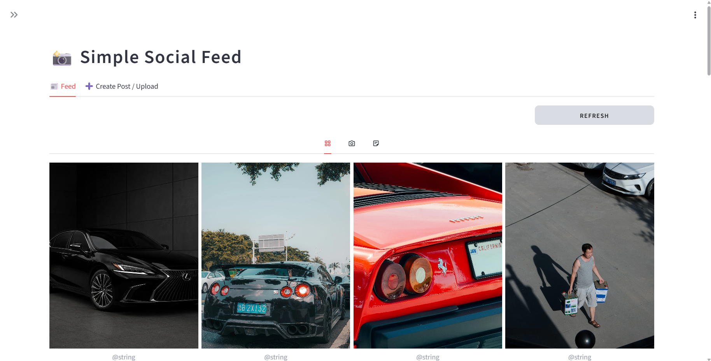
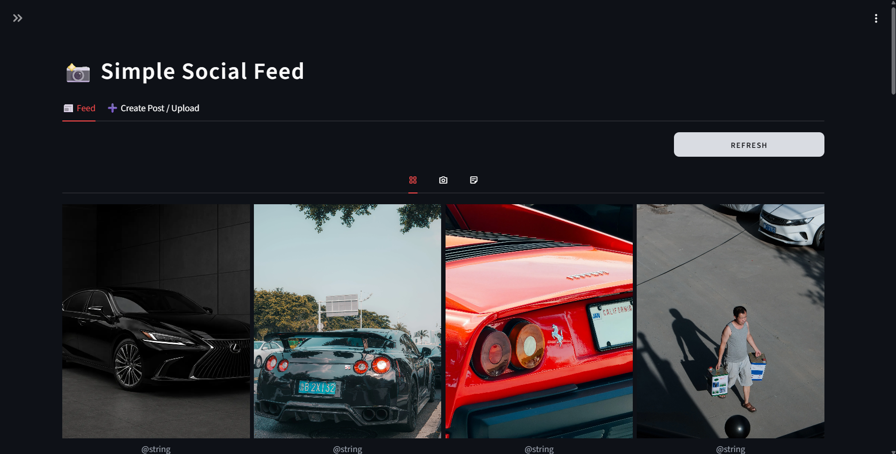
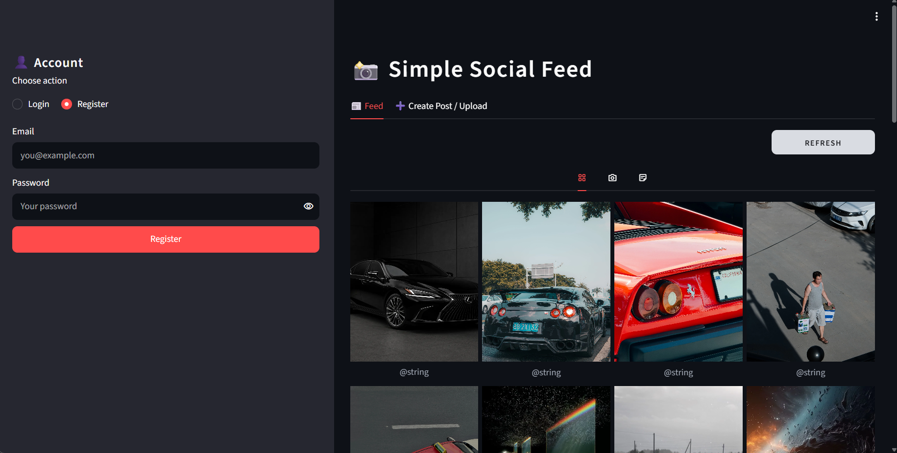
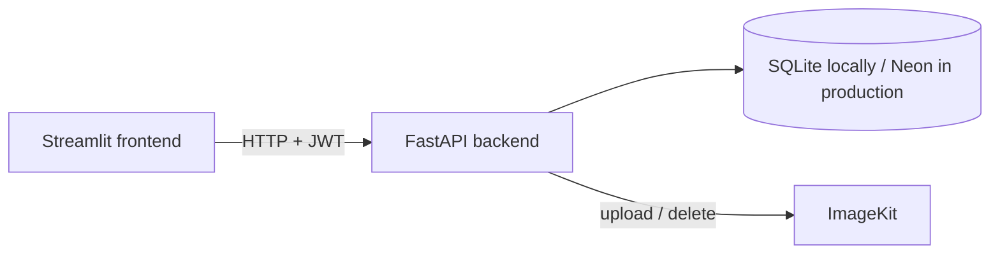

# Simple Social

**Simple Social** is a small, full-stack social feed built to explore how a modern web app fits together. Its Streamlit interface connects to a FastAPI backend, with JWT authentication, a database, email-based password resets, and cloud media storage.

## Try the live app

[Open Simple Social on Render](https://simple-social-frontend-j5wc.onrender.com/)

The feed is shared across all users, not isolated by account: posts, photos, videos, and notes are visible to anyone who opens the app. Create an account and log in to publish; you can edit or delete only your own posts. Please don't upload private or sensitive material.

## Product walkthrough

[Watch the demo video](https://github.com/AlexSashazmn/Simple-Social-Feed/releases/download/demo-simple-feed-api/demo_simple_social_feed.mp4) to see the app in action. It walks through the main experience:

- Request a password-reset email, set a new password, then log in and out.
- See that post deletion is restricted to the signed-in author.
- While signed in, publish text posts and upload photos or videos; text posts appear in the feed as notes.
- Switch between light and dark themes.

The screenshots below show both themes and the account sidebar.


## Screenshots
<table>
  <tr>
    <td align="center"><b>Light theme</b><br></td>
    <td align="center"><b>Dark theme</b><br></td>
    <td align="center"><b>Sidebar</b><br></td>
  </tr>
</table>

## Features

- **Authentication.** Registration, login, logout, and password-reset flows with JWT bearer tokens (`fastapi-users`). The session survives a browser refresh because the token is kept in a browser cookie.
- **Posts.** Photo and video uploads (stored on ImageKit) and text posts, shown as "notes".
- **Feed.** A full-width, four-column grid with tabs for everything, photos and videos, and notes.
- **Viewer.** Click a tile to open it at full size and move through the current tab with the arrow buttons. Long notes scroll inside the card.
- **Ownership and roles.** Users can edit and delete their own posts; delete controls are shown to the signed-in owner. Superusers can delete any post and sync the database with ImageKit.
- **Themes.** Switch between light and dark appearance.
- **User-friendly errors.** Clear messages explain common request failures without exposing raw server error pages. Temporary feed errors are retried, and uncertain post or upload results advise checking the feed before retrying.
- **Public reads.** The feed can be read without logging in. If a valid token is sent, each post also reports whether the caller owns it (`is_owner`).

## Architecture



| Layer | Tools |
| --- | --- |
| API | FastAPI, async SQLAlchemy, SQLite locally / PostgreSQL on Neon |
| Authentication | `fastapi-users` (JWT bearer) |
| Media storage | ImageKit (`imagekitio` 4.x) |
| Frontend | Streamlit, `streamlit-cookies-controller` |
| Tooling | `uv`, Python 3.13+ |

### Design decisions

- **Reads are public, writes are protected.** `GET /feed` uses optional authentication, so the same endpoint serves visitors and logged-in users.
- **Permissions are checked before side effects.** On delete, ownership is verified before anything is removed from ImageKit or the database.
- **Uploads clean up after themselves.** The file is sent to ImageKit first. If saving the row fails afterwards, the uploaded file is deleted again, so no orphan files remain.
- **No email addresses in public responses.** The author shown on a post is the user's `display_name`, or the part of their email before the `@` if none is set.
- **Input validation.** The upload form accepts multiple image and video files whose combined size is at most 200 MB. The API's `/upload` endpoint accepts one file per request, up to 200 MB.

## Project structure

```
fastapi v2/
├── app/
│   ├── app.py        # FastAPI app and endpoints
│   ├── db.py         # SQLAlchemy models (User, Post) and session setup
│   ├── users.py      # fastapi-users configuration: JWT strategy, user manager
│   ├── schemas.py    # Pydantic models
│   ├── images.py     # ImageKit client
│   ├── seed.py       # sample text posts for a given user
│   └── test.db       # SQLite database (created on first run, not committed)
├── frontend.py       # Streamlit UI
├── pyproject.toml
├── .env.eg           # example environment file
└── .python-version
```

## Getting started

### Prerequisites

- Python 3.13 or newer
- [uv](https://docs.astral.sh/uv/)
- A free [ImageKit](https://imagekit.io) account for photo and video uploads

### 1. Install

```bash
uv sync
```

Starting from an empty environment instead:

```bash
uv add fastapi "uvicorn[standard]" "fastapi-users[sqlalchemy]" aiosqlite python-dotenv python-multipart "imagekitio<5" requests streamlit streamlit-cookies-controller
```

### 2. Configure

```bash
cp .env.eg .env        # Windows (cmd): copy .env.eg .env
```

| Variable | Description |
| --- | --- |
| `SECRET` | Long random string used to sign JWTs and reset/verify tokens. Required. |
| `IMAGEKIT_PRIVATE_KEY` | ImageKit private key. |
| `IMAGEKIT_PUBLIC_KEY` | ImageKit public key. |
| `IMAGEKIT_URL` | ImageKit URL endpoint, for example `https://ik.imagekit.io/your_id`. |
| `RESEND_API_KEY` | Optional API key for password-reset and verification emails. |
| `EMAIL_FROM` | Optional sender address; defaults to Resend's test sender. |

Generate a secret:

```bash
uv run python -c "import secrets; print(secrets.token_urlsafe(64))"
```

Never commit `.env` or `app/test.db`. Both belong in `.gitignore`.

### 3. Run the backend

From the project root:

```bash
uv run uvicorn app.app:app --reload
```

The API runs at `http://127.0.0.1:8000`, with interactive documentation at `http://127.0.0.1:8000/docs` and a health check at `http://127.0.0.1:8000/health`. Tables are created automatically on startup.

### 4. Run the frontend

In a second terminal, from the project root:

```bash
uv run streamlit run frontend.py
```

Open `http://localhost:8501`. The backend address is the `API_URL` constant at the top of `frontend.py`.

### 5. Create a user and seed sample posts (optional)

1. Register in the sidebar of the app, or call `POST /auth/register` in `/docs`.
2. Add sample text posts for that user:

   ```bash
   uv run python -m app.seed you@example.com
   ```

   Running the seed twice does not create duplicates: titles that already exist for that user are skipped.

### Promoting a superuser

`fastapi-users` ignores `is_superuser` in the registration request, so promote a user directly in the database:

For the local SQLite database:

```bash
uv run python -c "import sqlite3; c=sqlite3.connect('app/test.db'); c.execute(\"UPDATE user SET is_superuser=1 WHERE email='you@example.com'\"); c.commit(); print('done')"
```

For Neon, run this in the Neon SQL Editor:

```sql
UPDATE "user" SET is_superuser = true WHERE email = 'you@example.com';
```

## Deploy with Render and Neon

The repository includes a Render Blueprint in [`render.yaml`](./render.yaml) that creates separate web services for the FastAPI API and Streamlit frontend.

1. Create a Neon project and copy its PostgreSQL connection string. Use the pooled connection string if needed for IPv4 compatibility; keep its `sslmode=require` query parameter.
2. In Render, choose **New > Blueprint**, connect this repository, and apply the Blueprint. Render will ask for `DATABASE_URL` and the ImageKit values; enter the Neon connection string and ImageKit credentials. Render generates `SECRET` automatically.
3. Wait for both services to deploy. Confirm the API's `/health` endpoint returns `{"status":"ok"}` and open the Streamlit service URL. The Blueprint links `API_URL` to the API's public Render URL.
4. For password-reset and verification email, create a [Resend](https://resend.com) account and API key. Add `RESEND_API_KEY` to the API service's environment in Render. Resend requires a verified sending domain for real delivery; verify a domain and set `EMAIL_FROM` to a sender on that domain. Its `onboarding@resend.dev` address is for testing only. Redeploy the API after changing environment variables.

The backend converts Neon `postgres://`/`postgresql://` URLs to SQLAlchemy's asyncpg driver and maps `sslmode` to asyncpg's `ssl` option. Post timestamps are stored as UTC values without a timezone offset to match the existing `TIMESTAMP WITHOUT TIME ZONE` column and work with both SQLite and Neon. The app creates tables on startup; this project does not yet have database migrations. Keep the Neon connection string and ImageKit private key in Render's environment settings, never in source control.

To deploy services manually instead, configure the API service with:

| Setting | Value |
| --- | --- |
| Build command | `pip install -r requirements.txt` |
| Start command | `uvicorn app.app:app --host 0.0.0.0 --port $PORT` |
| Health check path | `/health` |
| Environment | `SECRET`, `DATABASE_URL`, `IMAGEKIT_PRIVATE_KEY`, `IMAGEKIT_PUBLIC_KEY`, `IMAGEKIT_URL` |

Configure the Streamlit service with the same build command, start command `streamlit run frontend.py --server.address 0.0.0.0 --server.port $PORT`, and `API_URL` set to the API's public hostname or URL. The frontend accepts either a hostname or a URL. Both services use Render's free plan in the Blueprint and may spin down while idle, so the first request after inactivity can take longer.

Password reset and verification emails are sent through Resend when `RESEND_API_KEY` is configured; SMTP is also supported for local development. The app never writes reset or verification tokens to logs. The `/health/email` endpoint reports whether an email provider is configured, but a configured provider can still reject a message; check the API logs and Resend dashboard if an email does not arrive.

## API reference

Interactive documentation is available at `/docs`. Protected endpoints require the header `Authorization: Bearer <token>`.

| Method | Path | Access | Description |
| --- | --- | --- | --- |
| POST | `/auth/register` | Public | Create a user (`email`, `password`, optional `display_name`). |
| POST | `/auth/jwt/login` | Public | Log in with form fields `username` (the email) and `password`. Returns `access_token`. |
| POST | `/auth/jwt/logout` | User | Log out. |
| POST | `/auth/forgot-password`, `/auth/reset-password` | Public | Password reset flow. |
| POST | `/auth/request-verify-token`, `/auth/verify` | Public | Email verification flow. |
| GET, PATCH | `/users/me` | User | Read or update your own profile, including `display_name`. |
| GET, PATCH, DELETE | `/users/{id}` | Superuser | Manage any user. |
| POST | `/upload` | User | Upload one image or video (multipart: `file`, optional `caption`), up to 200 MB. The frontend accepts multiple files in a batch, with a 200 MB combined limit. |
| GET | `/feed` | Public | All posts, newest first. Includes `author` and `is_owner`. |
| POST | `/posts` | User | Create a text post (`title`, `content`). |
| GET | `/posts/{id}` | Public | Get one post. |
| PUT, PATCH | `/posts/{id}` | Owner | Edit your own post. |
| DELETE | `/posts/{id}` | Owner or superuser | Delete a post. Also removes its file from ImageKit. |
| DELETE | `/posts` | Superuser | Delete all posts. |
| POST | `/sync` | Superuser | Remove posts whose ImageKit file no longer exists. |

## Notes on the implementation

- The Streamlit app talks to the API over HTTP with `requests`. After login the JWT is stored in `st.session_state` and in a browser cookie, so a page refresh restores the session. If the token has expired, the app clears it and shows the login form.
- Select multiple files in the upload tab; the frontend checks that the combined batch is at most 200 MB and uploads the files sequentially, showing each result. Each request sends one file to the API, which allows up to 200 MB per file, sends it to ImageKit, and stores the returned URL and file id in the `posts` table. The combined 200 MB batch limit is enforced by the frontend.
- Posts with a `url` are rendered as photos or videos. Posts without one are rendered as notes.

### Known gotchas

- **UUID format.** `fastapi-users` stores user ids as `CHAR(36)` with dashes. `Post.user_id` must use the same type (`GUID` from `fastapi_users_db_sqlalchemy.generics`). Otherwise the join between posts and users silently fails and every author shows as `anonymous`. SQLite does not enforce foreign keys by default, so no error is raised.
- **Imports.** `SQLAlchemyBaseUserTableUUID` and `SQLAlchemyUserDatabase` must be imported from `fastapi_users_db_sqlalchemy`, not `fastapi_users.db`.
- **Backend imports.** Start the backend from the repository root as `uvicorn app.app:app`; the package-relative imports also work with Render's start command.
- **No migrations.** Tables are created with `create_all`. Changing a column on an existing database means editing it by hand or recreating `test.db`.

## Troubleshooting

| Problem | Fix |
| --- | --- |
| Feed shows "Backend server is offline" | Start the API (step 3) and check `API_URL` in `frontend.py`. |
| `RuntimeError: SECRET is not set in .env` | Create `.env` from `.env.eg` and set `SECRET`. |
| All authors show as `anonymous` | See "UUID format" above. |
| Logged out after a refresh | The token expired or cookies are blocked. Log in again. Token lifetime is set in `get_jwt_strategy()` in `app/users.py`. |
| Upload returns 400 or 413 | Only images and videos up to 200 MB per file are accepted by the API. In the frontend, the combined size of one multi-file batch must be 200 MB or less. |
| Upload returns 502 or 500 | Check the ImageKit keys and URL endpoint in `.env`. |
| Page looks stale after editing CSS | Hard refresh with `Ctrl+F5`. |

## Roadmap

Before exposing the app to the internet:

- [ ] Add Alembic migrations before evolving the Neon schema.
- [ ] Configure an email provider for password reset and verification (`SMTP_USER`, `SMTP_PASSWORD`, and optionally `SMTP_HOST`/`SMTP_PORT`).
- [ ] Move the login token out of a JavaScript-readable cookie (a Streamlit limitation). A public deployment should use a frontend that supports HttpOnly cookies.
- [ ] Add rate limiting on `/auth/*` and `/upload`.
- [ ] Validate uploads by file contents as well as the client-supplied `Content-Type` header.
- [ ] Run with multiple workers, add logging and monitoring, and containerize with Docker.
- [ ] Add automated tests and a CI pipeline.
